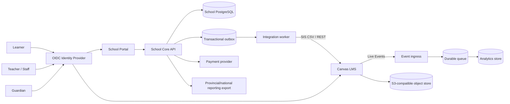

# Target architecture

## Principles

1. **Canvas is the learning management system, not the SIS.** Keep official identity, admissions, fees and records in School Core.
2. **API first, no Canvas database coupling.** Use Canvas REST/SIS/LTI/Live Events; direct database writes create unsafe upgrade coupling.
3. **Modular monolith first.** A local high school does not need dozens of microservices. Clear modules plus an outbox give simple operations and an extraction path.
4. **Privacy and safeguarding by design.** Minimise child data, encrypt it, log privileged access, and make risk alerts assist—not replace—human judgement.
5. **One identity.** OIDC single sign-on and multifactor authentication for staff; stable opaque IDs, not email addresses, connect systems.

## Context

## Deployable units

| Unit | Responsibility | Scale trigger |
|---|---|---|
| Canvas web | Learning UI and APIs | request latency/CPU |
| Canvas jobs | Delayed jobs, mail, content processing | queue age |
| School Core API | learners, guardians, official enrolment, fees, audit | request latency |
| Integration worker | SIS/API synchronisation and retries | outbox age |
| Event ingress | validates/deduplicates Canvas events | ingress rate |
| Reporting worker | aggregates engagement/grades | scheduled batch duration |
| Admin web | role-sensitive operational UI | CDN/static |

Start the custom control plane as one modular codebase and separate workers by process. Extract a service only when ownership, scaling, security boundary, or availability differs measurably.

## Canvas integration contract

- Prefer nightly/full and intra-day/diff **SIS imports** for people, terms, courses, sections, and enrolments. Generate deterministic files, store checksums, poll import completion, reconcile errors, and require approval before destructive batch mode.
- Use **REST** for low-volume commands and immediate reads. Follow the opaque pagination links. Honour `X-Request-Cost`/`X-Rate-Limit-Remaining`, cap concurrency, retry only safe/idempotent operations, and add idempotency at School Core.
- Use **LTI 1.3** for embedded tools. Validate OIDC state/nonce, JWT issuer/audience/signature/deployment, rotate JSON Web Keys, request only required Assignment and Grade Services (AGS) / Names and Role Provisioning Services (NRPS) scopes, and protect third-party-cookie fallbacks.
- Use **Live Events** for timely signals, but assume duplicates and late/out-of-order delivery. Persist event ID, verify the configured transport, acknowledge only after durable write, and reconcile periodically through APIs/data exports.
- Never treat analytics or events as the official mark record; reconcile final marks against Canvas Gradebook and obtain approval before publishing transcripts.

## Data ownership and identifiers

Every person receives an internal UUID. `sis_id` is a unique external key and Canvas IDs are mappings, never primary keys. Legal name is access-restricted; preferred name is used in normal UI. Money is stored as integer minor units with an ISO currency code. Mutations use a version number to stop silent lost updates.

## Availability and recovery targets (proposal; approve before contract)

| Tier | Examples | Proposed RTO | Proposed RPO |
|---|---|---:|---:|
| A | login, Canvas courses/submissions | 4 h | 15 min |
| B | attendance, learner administration | 8 h | 1 h |
| C | analytics, bulk reports | 2 business days | 24 h |

RTO is recovery time objective; RPO is recovery point objective. Run quarterly restoration tests. Cross-region/object-lock backups are useful only when restoration is verified.

## Production topology

For one school, use a managed Kubernetes service only if the operator already has that competence. A simpler supported virtual-machine/container platform with managed PostgreSQL, managed Redis and object storage is often safer. If Kubernetes is selected: separate namespaces, network policies, pod disruption budgets, topology spread, immutable images, autoscaling on queue age as well as CPU, and GitOps deployment. Do not autoscale databases blindly.

## Upgrade strategy

Carry no Canvas core fork initially. Keep theme overrides small, build richer functions as LTI/external applications, and pin Canvas to an immutable reviewed commit. Monthly: test upstream update in staging, run smoke/SIS/LTI/accessibility suites, back up, deploy canary, then promote. Maintain a compatibility matrix for Canvas, browser, API and LTI versions.
