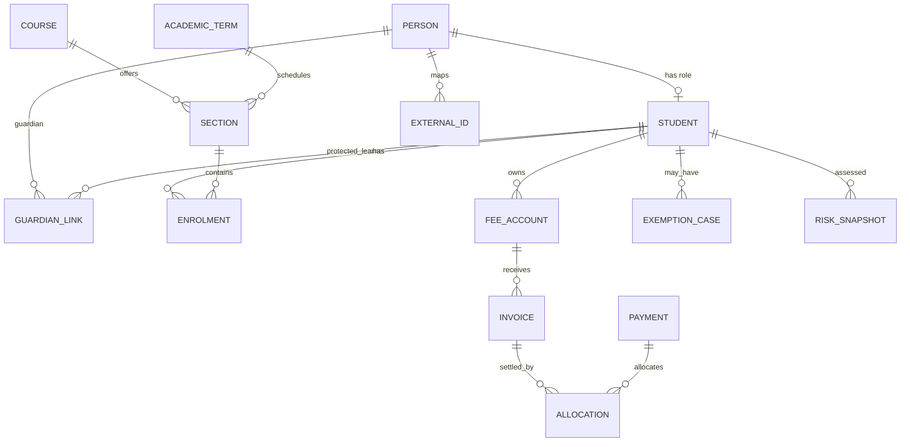

# Logical data model

The executable slice currently implements `Student`, `AuditEvent`, `OutboxEvent` and Canvas ID mapping. Remaining entities wait for policy discovery to avoid encoding the wrong local rules.

## Invariants for later modules

- A guardian link includes relationship, legal authority, contact permission, emergency priority, start/end dates and verification evidence; “parent” is not assumed to mean account access.
- Enrolment status is effective-dated. A transfer or withdrawal must not erase history.
- Finance uses double-entry or an established accounting integration. Invoice totals and balances are derived from immutable charges, credits, allocations and reversals—not directly edited.
- Mark calculation stores assessment policy/version, source marks, moderation, approval and publication events. Never overwrite the evidence used for a report.
- Attendance stores session, state, recorder, timestamp, reason and amendments. Corrections are audit events.
- Safeguarding/health records belong in a separately authorised module and are excluded from general search, analytics and Canvas sync.
